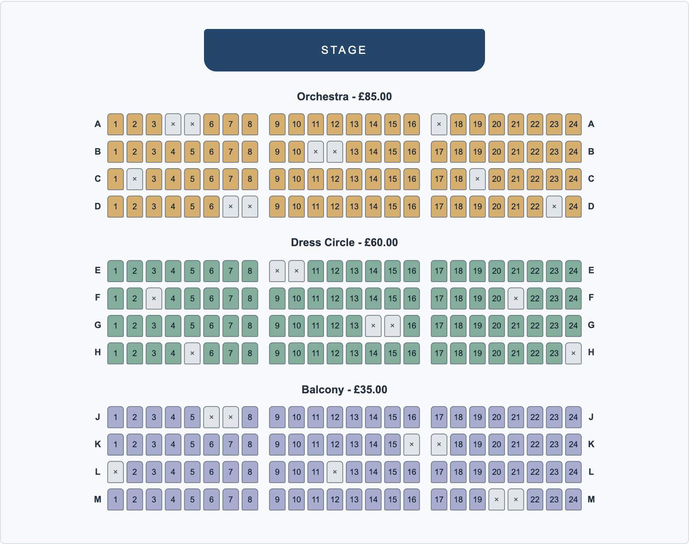

# Aster Theatre - WM1 project

Farid Guliyev

An interactive ticket-selection website for Web & Mobile I. I chose a theatre with 288 seats, split into Orchestra, Dress Circle and Balcony.

## Current stage

**Integration and final quality - 6 November 2026.** The fourth source milestone includes the required ticket-selection features, mouse navigation and the final requirement review. The demonstration video and completed report are separate submission steps; see `docs/requirements.md` for the outstanding items.

What is included:

- A responsive HTML and CSS page with 288 seat buttons generated from the venue data.
- Seat details showing section, row, number, category, price and availability.
- Separate styles for available, inspected, in-cart and unavailable seats.
- Seven map controls: Zoom In, Zoom Out, Move Up, Move Down, Move Left, Move Right and Reset/Center View.
- Explicit ADD TO CART, duplicate prevention, removal, individual prices and a running total.
- Cart IDs saved in localStorage and restored on reload, including the in-cart map state.
- Keyboard navigation between seats and a link to the details panel on smaller screens.
- Mouse-wheel zoom and left-button dragging, without selecting a seat after a drag.

Clicking a seat only inspects it. Use ADD TO CART in the details panel to select a ticket. Unavailable seats can be inspected, but cannot be added. This is a browser demonstration and does not reserve real tickets.

## Run

There are no dependencies or build steps. For consistent browser storage behavior, serve the project from its folder:

```sh
python3 -m http.server 8000
```

Then open `http://localhost:8000`. Keep using the same browser and address to restore the saved cart. Opening `index.html` directly also displays the page, but storage on file URLs depends on the browser.

## Venue plan

| Section | Rows | Seats | Price |
| --- | --- | --- | --- |
| Orchestra | A-D | 96 | GBP 85 |
| Dress Circle | E-H | 96 | GBP 60 |
| Balcony | J-M | 96 | GBP 35 |

Each row contains 24 seats. Aisles are after seats 8 and 16. The data marks 26 seats unavailable. Prices are stored in pence. Row I is skipped to avoid confusion with the number 1.



## Files

- `index.html`: page layout, controls and cart panel.
- `style.css`: responsive layout and seat states.
- `venue.js`: venue data and `createSeats()`, which makes the individual seat records.
- `script.js`: map generation, inspection, keyboard focus, cart and saved selections.
- `navigation.js`: map zoom, movement, limits and centering.
- `assets/venue-plan.svg`: original layout sketch, kept as a design reference.
- `docs/progress.md`: actual progress and next steps.
- `docs/testing.md`: checks for the current stage.
- `docs/requirements.md`: requirement-by-requirement review and submission status.
- `docs/demo-guide.md`: the required 4-6 minute recording sequence and upload checks.

## Using the map and cart

The map starts with the complete venue fitted inside its frame. Zoom In enlarges it in 25% steps, up to 400% of the fitted view. The direction buttons move the map; movement is limited so the venue stays reachable. Reset/Center View shows the complete venue again. Resizing the window or rotating a phone also refits the map.

With a mouse, scroll over the map to zoom around the pointer in 15% steps, or hold the left button and drag to pan. A small movement still counts as a click; a drag does not inspect a seat. The seven navigation buttons remain available, including on touch screens. Ctrl/Command plus the wheel is left to the browser's zoom handling.

Click a seat to inspect it, then use ADD TO CART. Added seats show a tick. The inspection outline stays separate from the cart state, so inspecting another seat does not remove any tickets. Use Remove beside a ticket to return it to the available state and update the total.

With a keyboard, Tab into the seats, use the arrow keys to move, and press Enter or Space to inspect. Arrow keys move focus without changing the inspected seat. Focused seats are brought into view when zoomed. Use the "View seat details" link below the map to reach the details panel.

Only seat IDs and a format version are saved under `wm1-aster-theatre-cart`. Prices and availability come from the current venue data. Restoration ignores duplicate, unknown and unavailable IDs. A damaged saved value or blocked browser storage produces a visible warning. The cart can still be used during that visit if saving is blocked. Open tabs using the same address also receive cart updates.

## Submission status

The repository is public and contains the runnable source. The source has been tested; exact coverage is in `docs/testing.md`.

Still required: the personally narrated OneDrive demonstration, generated automatic subtitles, a checked public video link, and the final report containing that link and the exact submitted commit. The existing history does not meet the required three meaningful commits per week across four weeks. This is documented in `docs/requirements.md` and needs discussion with the instructor.

The assignment deadline is 8 November 2026. Commits should record actual work when it happens; they should not be backdated or made only to increase the count.
